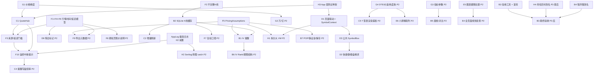

# 修复计划与依赖分析（04）

> 编写：2026-11-12（UTC+8）。依据：`docs/03-开发复盘.md` 第 B–H 节的 46 条发现，以及对 `src/` 代码的逐项核对。
> 用户指令（t17u/t18u）：依次修复 P0 → P1 → P2 → P3，要先理清依赖、排好顺序；修复过程中不再逐项授权。
> 本文是**排期依据**；每条做完后在第 5 节登记提交号，并同步写入 `docs/02-中断恢复记录.md`。

## 1. 核对代码后对依赖的修正

| 原先的假设 | 核对结果 | 对排期的影响 |
|---|---|---|
| F1、F4、F6 共用一个“时间戳/延迟”模型 | 属实。三者都改 `SourcedData`（`AsOf`/`IsRealtime`/`DelayMinutes`）和各 Provider 的赋值；界面上的“实时/延迟 N 分钟/近实时”判断在 `DashboardViewModel`、`WatchlistViewModel` 各写了一遍 | F1（P0）和 F4、F6（P1）**合并为一次改动**：新增 `FetchedAt`、`DelayMinutes` 改为可空（null = 未知），判断逻辑收口到 Core 的 `DataFreshness`。分开做会让每个 Provider 被改两遍 |
| F2 只影响 Yahoo | **不属实**。Nasdaq 日线、新浪日线、CBOE 日线和分钟线也用收盘价补开高低；腾讯分时只有一个价格，却被做成 O=H=L=C；`BarAggregator` 用 `Math.Max/Min` 合并，遇到缺失值会被污染 | F2 范围扩大到 6 处 + 聚合器 + 指标 + 画图 + 导出。`Bar` 增加 `Incomplete` 标记，缺失字段存 NaN（不再造数） |
| D1 联动需要一个共享的“当前标的” | 属实。K 线、期权、策略、新闻各自有 `SymbolText`，`NavigationHub` 只认识提醒页和 K 线页 | 新建 `SymbolContext`（当前标的 + 变更事件），`NavigationHub` 统一按页面把标的交给对应 VM。D3（公共 `SymbolBox`）和 D2（键盘精灵）都复用它，所以顺序是 **D1 → D3 → D2**。H1（P2）以后在此基础上把各 VM 的重复代码收口 |
| C1 QuoteHub 是 F3、F10 的地基 | 属实。概览、自选、提醒各自一个 `DispatcherTimer` 调 `GetQuotesAsync`；`AlertMonitor` 失败时 `catch { return; }` | **C1 → F3 → F10**。F10 的“连续失败计数”放在 Hub 上，所有订阅者共享同一份健康状态；C4（P2，提醒写盘频率）改的是同一段代码，排在 P2 开头 |
| F10 需要日志 | 属实；H2（Serilog，P2）尚未做 | 本轮先加一个极简 `AppLog`（按日滚动的文本日志、线程安全、限大小），F10 和新代码都写它。H2 在 P2 只需替换 `AppLog` 的后端并清理旧的宽泛 `catch`，**不会返工** |
| F5 是 B7 的前提 | 属实。`OptionsViewModel.DefaultRate` 和 `StrategyViewModel.DefaultRate` 各写死 0.04 | F5 抽出 `PricingAssumptions` 服务（利率来源：固定值 / 13 周国债 ^IRX；模型标注），期权页、策略页、B1 的 ATM IV 兜底计算共用；B7（P2）的 POP 和保证金也用它 |
| G1 和 G2 用同一个格式化类 | 属实。`NumberDisplay` 已在 Core（`StatementTable.cs`），但价格格式在 5 个 VM 里各写一遍 | G1 把价格分级放进 `NumberDisplay.Price` 并替换所有调用点；G2（P2）在同一个类里加万/亿 |
| B2 缓存、C2 增量刷新、F2、F7 都动 K 线管线 | 属实 | 顺序 **F2（P0）→ B2 → C2**。缓存表结构一次定好：主键含 `adjust`（复权口径，F7 用），每根柱带 `incomplete` 和 `source`，避免 P2 做 F7 时迁移表结构 |
| B1 需要 IV 采样，B6 要复用历史 | 属实。CBOE 报价接口自带 `iv30` 字段（fixture 已确认） | B1 排在 B2 之后：IV 样本写进同一个 SQLite 库的 `iv_samples` 表，B6（P2）直接用它算 IV Rank |
| B4 改程序集名会影响 Toast、Inno、pack.ps1、便携版、托盘 | 属实，另外还有一处**隐藏依赖**：`LocalizationService` 用 `pack://application:,,,/TyuStockApp;component/...` 加载语言包，程序集改名后会直接找不到资源 | B4 放在 P1 最后（在 B3 首轮验收之前），同时改 pack URI、`build/*.ps1`、`setup.iss`、SEC 的 User-Agent。数据目录名早已改为“美丽稻谷终端”，不受影响 |
| H4 内部命名空间改名是否和 B4 一起做 | 命名空间对用户不可见（B4 已让文件属性、进程名不含 tyu）；而改命名空间会触及全部 140 多个文件 | **不一起做**。H4 放在 P3 的最后、所有功能改完之后，作为一次纯机械的改名提交。理由：P1/P2 期间还有约 40 条改动要改这些文件，提前改名会让每条改动的 diff 都混进大量无关行，也让中断恢复更难核对 |
| H3 是 P1，但应该先做 | 属实。后续每条 UI 改动都需要回归保护（M7 那次崩溃就是 XAML 资源问题） | H3 放在**最前面**作为基础设施：新建 `TyuStock.App.Tests`（STA 线程逐页实例化 + 假的 `IMarketDataService`） |
| B3 是 P0，但只有最终版本才有意义 | 属实 | 本轮先做验收工具：应用内 `--smoke` 自检模式（窗口放在屏幕外、不进任务栏，逐页加载并写 JSON 报告后退出）+ `build/acceptance.ps1`（便携版运行、静默安装到 scratch、卸载后数据保留）。本轮末在当前代码上跑首轮；P3 结束、出安装包后跑最终一轮 |
| E1、D4 互相独立 | 属实 | 放在 P1 后段，和其他项无先后约束 |

## 2. 依赖图

## 3. 执行顺序

### 第 1 批（本次）：基础设施 + P0 + P1

| 序 | 编号 | 级 | 做什么 | 为什么排在这里 |
|---|---|---|---|---|
| 1 | H3 | P1 | `TyuStock.App.Tests`：STA 线程逐页加载、ViewModel 注入假数据服务 | 后面所有 UI 改动的回归网 |
| 2 | （H2 前置） | — | `AppLog` 极简文件日志 | F10 要写日志；H2 以后只换后端 |
| 3 | F1 + F4 + F6 | P0+P1 | `FetchedAt`、可空 `DelayMinutes`、`DataFreshness`；国内源标“延迟未知/实测滞后”；Nasdaq 只信源字段；期权链和基本面不再把抓取时间当行情时间 | 同一模型，一次改完 |
| 4 | F2 | P0 | `Bar.Incomplete` + NaN；6 处 Provider、聚合器、指标、画图、导出 | 必须在 B2 之前定好柱结构 |
| 5 | D1 | P0 | `SymbolContext`；自选双击/右键 → K 线/期权/策略/新闻；期权 T 型表右键“以此建策略” | D3、D2 的前提 |
| 6 | G1 | P1 | `NumberDisplay.Price` 分级精度，替换全部调用点 | C1 会重写概览/自选的格式化代码，先统一格式 |
| 7 | C1 | P1 | `QuoteHub`：合并订阅、一次请求、广播、2.5 秒 TTL；概览/自选/提醒改用它 | F3、F10 的地基 |
| 8 | F3 | P1 | 概览卡片显示来源和时效；提醒“可接受最大延迟”设置，超过则跳过并计数，通知正文注明来源与时效 | 依赖 1、7 |
| 9 | F10 | P1 | Hub 连续失败计数；提醒页 InfoBar 和托盘提示“监控中断”；写日志 | 依赖 2、7、8 |
| 10 | B2 | P1 | `MarketDb`（SQLite）+ K 线缓存装饰器（先出缓存、后台补新，离线可看） | 依赖 4 |
| 11 | C2 | P1 | 只拉尾部并合并；数据没变就不重画；保留用户缩放 | 依赖 10 |
| 12 | F5 | P1 | `PricingAssumptions`：设置里选“固定利率/13 周国债 ^IRX”，期权页、策略页标注“模型：BSM（欧式）r = x%” | B1 兜底计算和 B7 都用 |
| 13 | B1 | P1 | IV 提醒（IV30 上穿/下穿），5 分钟低频采样，CBOE `iv30` 优先，失败时用最接近 30 天到期的 ATM IV；样本落盘 | 依赖 10、12 |
| 14 | D3 | P1 | 公共 `SymbolBox`（联想 + 自选下拉），K 线/期权/策略/新闻页替换文本框 | 依赖 5 |
| 15 | D2 | P1 | Ctrl+1…9 切页、F5 刷新、Esc 关闭弹层、任意位置打字弹出键盘精灵 | 依赖 14 |
| 16 | D4 | P1 | 设置“关闭按钮：最小化到托盘/退出”，首次关闭时询问 | 独立 |
| 17 | E1 | P1 | 健康色改用中性色系（蓝/琥珀/灰）+ 图标；英文界面首次启动默认绿涨 | 独立 |
| 18 | B4 | P1 | `AssemblyName` → `MeiliTerminal`；pack URI、脚本、Inno、AUMID、SEC UA | 放最后，避免影响前面每次构建脚本 |
| 19 | B3（首轮） | P0 | `--smoke` 自检 + `build/acceptance.ps1`，在当前代码上跑一遍并记录 | 工具覆盖本轮全部新功能 |

### 第 2 批（下次）：P2

| 序 | 编号 | 理由 |
|---|---|---|
| 1 | H2 | Serilog 接管 `AppLog`，清理约 15 处宽泛 `catch`；先做，后面新增的代码直接用 |
| 2 | C4 | 和 C1/F10 同一段代码，趁热改 |
| 3 | D8 | 用第 1 批的时效模型和 Hub 健康状态 |
| 4 | F8 → F9 | 都依赖时效模型；F9 还要写入 F5 的利率假设 |
| 5 | F7 | 缓存主键已预留 `adjust` |
| 6 | G2 → E2 | 同一格式化类，再统一等宽数字 |
| 7 | G4 → C5 → E6 | 先加列，再测渲染基准，最后给小屏做精简列 |
| 8 | C3 | CBOE 刷新节奏和后台解析 |
| 9 | G3 → B5 | 先有指标参数持久化，再做画线和对比叠加 |
| 10 | B6 | 用 B1 落盘的 IV 样本 |
| 11 | B7 | 用 F5 的 `PricingAssumptions` |
| 12 | D5、D6、D7 | 文案、跨分组、首次启动网络引导 |
| 13 | H1 | 功能都落地后再拆大 VM，避免边拆边改 |
| 14 | E5 → E4 | 先让图表跟随主题，再做全页面 × 深浅色 × 中英文视觉走查 |
| 15 | C6 | 功能稳定后建立启动/内存基线 |

### 第 3 批：P3 与收尾

| 序 | 编号 | 内容 |
|---|---|---|
| 1 | B8 | 免费源没有盘口和逐笔：写进使用说明和“关于”，不做 |
| 2 | B9 | 核对 M11 削减项是否都已被 D2、D7、H2、C6 覆盖，写结论 |
| 3 | H4 | 命名空间 `TyuStock.*` 机械改名 + 清理 `scratch\`（最后做，见第 1 节） |
| 4 | B3（最终） | 用最终安装包和便携版跑 `build/acceptance.ps1`，结果写入 docs |
| 5 | 交付 | `Installers\` 下三个子目录（Windows 便携版、Windows 安装版、macOS 版——可行性另行评估） |

## 4. 已知不可行或需要说明的项

- **B8**：免费、免注册的数据源都不提供 Level 2 盘口和逐笔成交，只能在文档里说明。
- **B3 中“点击 Toast 跳转”**：自动化验收不能在用户桌面上弹出通知并替他点击。本轮用单元测试覆盖“通知参数 → 导航”的路由，用 `--smoke` 验证通知组件能初始化；真正点一次通知留在用户验收清单里。
- **macOS 版**：WPF 只能运行在 Windows 上，见第 3 批第 5 条，届时单独评估（可能需要把界面层移植到 Avalonia）。

## 5. 进度登记

| 编号 | 状态 | 提交 | 说明 |
|---|---|---|---|
| H3 | 完成 | ff73a50 | App.Tests 项目：9 页 × 中/英 × 深/浅离屏加载、关键 VM、字符串一致性、宿主安全测试 |
| F1+F4+F6 | 完成 | 2b24d01 | FetchedAt/可空延迟/DataFreshness；国内源与 Nasdaq/Yahoo/CNBC 只信源字段；期权链/基本面不再用抓取时间；+ 极简 AppLog |
| F2 | 完成 | e55fe57 | Bar.FromSource/CloseOnly/Incomplete；全部 7 处伪造点改掉；聚合忽略 NaN 并传播标记；KDJ 只用完整 K 线；绘图把不完整 K 线画成收盘点，全不完整画折线；导出 NaN 为空并加“数据不完整”列 |
| D1 | 完成 | 37bb955 | SymbolContext 共享当前代码：K线/期权/策略/新闻任一页加载即设定，其它页显示时自动跟随；NavigationHub 带代码可达任一页；自选双击开 K 线、右键开期权链/策略/新闻；期权 T 型表右键“以此行权价建策略”（买/卖 看涨/看跌）→ 策略页自定义单腿；顺带修复换代码后沿用旧到期日 |
| G1 | 完成 | d8846af | NumberDisplay.Price 按价位分级（<1 至 4 位、1–10 至 3 位、其余 2 位、≥1000 千分位）+ SignedChange；概览/自选/K线十字线/期权/策略/新闻/提醒通知统一；提醒阈值不再受系统区域影响 |
| C1 | 完成 | d8846af | Core/Quotes/QuoteHub：订阅合并、2.5 s TTL、同请求合并（single-flight）、顺带刷新其它订阅者的过期代码、失败计数；App 层唯一定时器 QuotePump；概览/自选/提醒改为订阅 + 监听，不再各自起定时器 |
| F3 | 完成 | a5d1014 | AlertQuoteGate：声明延迟或实测滞后超过阈值（默认 20 分钟，提醒页可选 5–60）的报价不参与判定并在提醒页注明；延迟未知照常判定但通知里写明来源与时效；概览卡片的来源/时效已在 F1 完成 |
| F10 | 完成 | a5d1014 | MonitorHealth：连续 N 次（默认 3）取不到提醒代码的行情 → 提醒页错误横幅 + 托盘气泡（每次中断只提示一次），恢复时再提示；全部写 AppLog |
| B2 | 完成 | d2b0d0a | Data/Cache/MarketDb（SQLite：bars/bar_meta/iv_samples/schema_version，NaN 存 NULL）+ CachedMarketData 装饰器：首次全量、之后只拉带 5 根重叠的尾巴并合并；换源/重叠不一致（拆股、复权）/断档 → 全量重建；断网返回缓存并标“离线缓存”；最多保留 6000 根 |
| C2 | 完成 | d2b0d0a | 刷新只拉尾巴（经 B2 缓存层）；数据无变化时不重算、不重绘（SameData）；有新数据时保留用户缩放/平移，换代码/周期才自适应。指标仍全量重算：500 根 × 6 个指标在 1 ms 量级，增量算法会让 EMA/MACD/KDJ 的状态管理复杂且易错，收益可忽略，故有意不做 |
| F5 | 完成 | b30f2a0 | Core/Pricing/RiskFreeRateProvider：默认取 13 周美债收益率 ^IRX（6 小时缓存，失败 15 分钟内不重试，异常值拒收），失败按固定利率并标明“兜底”；设置页可选固定利率（-1–20%）；期权/策略页显示“模型：BSM（欧式）· r = x%（来源）”，悬停说明美式提前行权偏差。二叉树美式校正未做（需逐合约迭代且免费源缺分红日程，收益与风险不成比例），在说明中如实提示 |
| B1 | 完成 | 85959ac | 新增提醒类型“隐含波动率升至/降至”（阈值为百分数）。IvAlertSampler 每 5 分钟取样：优先 CBOE 报价自带的 IV30，取不到时用约 30 天到期（≥7 天）的平值 IV（看涨/看跌平均，缺 IV 时按 F5 利率本地反解）；样本写入 market.db 的 iv_samples（保留 400 天，供 B6 IV Rank）；IV30 与平值 IV 口径切换时只重设基准、不触发；过期样本按 F3 同一延迟门槛跳过；提醒页显示每个代码的最新读数和口径，失败时注明 |
| D3 | 完成 | 41940a5 | 公共控件 Views/Controls/SymbolBox：输入即联想（自选里前缀匹配优先、再包含匹配，然后是搜索结果，300 ms 防抖、10 分钟缓存），右侧下拉按钮列出全部自选，↓/↑/Enter/Esc 键盘操作，回车或点选即加载；搜索失败时注明并只显示自选匹配。K 线、期权、策略、新闻、提醒五页替换原来的可编辑下拉框 |
| D2 | 完成 | f872b29 | Services/KeyboardShortcuts（Ctrl+1…9 含小键盘切页、F5 调当前页的刷新命令、打字触发判断）；MainWindow 预览键盘事件；键盘精灵为窗口顶部浮层（内嵌 D3 的 SymbolBox），不在输入框时直接打字即弹出，回车打开 K 线，Esc 或失焦关闭；设置页新增“快捷键”说明卡片 |
| D4 | 完成 | e9cca35 | AppSettings.CloseAction（询问/最小化到托盘/退出，默认询问）+ CloseDecision；第一次点关闭弹出 WPF-UI 对话框（最小化到托盘/退出/取消），选择后记住，设置页可改；藏到托盘时每次运行提示一次“仍在后台运行，提醒照常工作”；`--exit-on-close` 和托盘“退出”不受影响 |
| E1 | 完成 | 70fb8b8 | 健康色改为中性色系：正常蓝 #3B82D6、降级琥珀 #B07408、故障石板灰 #7A8594、未知灰，与红/绿涨跌色在两种约定下都不重合；数据源卡片用图标（对勾/警告/错误/问号）+ 文字表达状态，不再只靠颜色。AppSettings.UpDownColorsChosen + EffectiveUpDownColors：用户没选过涨跌色时跟随界面语言（中文红涨、英文绿涨），切换语言即时生效；旧配置里选过绿涨的视为已选择 |
| B4 | 完成 | 8cddf10 | App 程序集名 TyuStockApp → MeiliTerminal（资源管理器“原始文件名”、任务管理器进程名、app.manifest）；字符串字典 pack URI 改为运行时取程序集名；Data 的 InternalsVisibleTo、pack.ps1/run-dev.ps1/shot.ps1/采集脚本同步；SEC User-Agent 改为 MeiliTerminal/0.3。AUMID 本来就是 MeiliDaogu.SellerTerminal，未变。说明：TyuStock.Core/Data/Analytics 这几个内部类库名和命名空间暂不改（单文件发布时打包在 exe 内部，用户看不到；改名牵动面大，放到 P3 评估）；解决方案文件名 TyuStockApp.slnx 属于开发目录，不对用户可见 |
| B3（首轮） | 完成 | fc693c9 / 797948b | `--smoke` 内置自检 + build/acceptance.ps1；Debug 与 Release 单文件（含便携布局）各跑一遍，全部通过，记录见 docs/05-验收记录.md；顺手去掉发布目录里的类库 XML 文档。安装/卸载、托盘、Toast、首次关闭对话框、真实按键列为人工确认项 |

### 第 2 批进度（P2）

| 编号 | 状态 | Windows 提交 | 说明 |
|---|---|---|---|
| H2 | 完成 | c3d013f | 全仓库宽泛 catch 清理：吞掉异常的地方改为写 AppLog（错误级带完整堆栈，警告级带根因）；VM 的失败路径在显示给用户的同时写日志；打不开新闻链接时给出提示；NotificationService 不再单独写 alerts.log，统一进 app 日志；补上 AppDomain/未观察 Task 异常日志；设置/提醒文件损坏时记错误日志。确属预期的静默（日志自身、代理探测、时区回退）都加 `// expected:` 说明。新增扫描测试：src 中任何宽泛 catch 不记录、不重抛、不上报就失败。Serilog 评估后未引入：AppLog 已有按日滚动、限大小、14 天保留，再加依赖只会增大单文件 exe |
| C4 | 完成 | 9b896db | 提醒状态写盘合并：LastSeen*/HasSeenQuote 只在内存更新，最多每 2 分钟写一次 alerts.json；触发、规则修改、历史变化仍立即写；AlertMonitor/IV 采样停止与程序退出时 Flush；后台写盘失败只记日志并重试 |
| D8 | 完成 | af7bfd1 | 价格旁显示行情时间（美东 HH:mm，无市场时间时用抓取时间）；连续 3 个刷新周期（至少 2 分钟）未能刷新或实测滞后超 20 分钟时显示琥珀色“过期”标记（深色文字保证两种主题对比度），悬停说明原因；声明延迟（如 15 分钟）不算过期；所有数据源失败时概览与自选页顶部弹出 InfoBar，附“查看数据源”按钮 |
| F8 | 完成 | 9a04df8 | 期权/策略页标的价改为期权链自带的标的价并注明“与期权同步，延迟 N 分钟”（IV/希腊值基于它计算），旁边显示股票行情的最新价及来源/时效作对照（悬停说明）；链中无标的价时注明取自股票行情或昨收；标题行改为可换行，窄窗口不截断 |
| F9 | 完成 | 46f73cd | 导出附带来源说明：XLSX 增加“导出信息”工作表（表名/项目/内容，均存为文本），CSV 在数据后空一行写入；内容来自与界面相同的时效模型——导出时间（含时区）、数据源、时效（实时/延迟 N 分钟/实测/未知）、数据时间（美东）、抓取时间、期权导出另含定价假设（模型与利率）与标的价口径；自选导出注明各行来源见列 |
| F7 | 完成 | dbd7aab | K 线复权口径：BarSeries 增加 Adjustment（未复权/拆股调整不含分红/拆股+分红/未知），各数据源标注（Yahoo/Nasdaq 拆股调整，腾讯/东财前复权）；K 线页显示口径标签并提供“含分红复权”开关（Yahoo adjclose，按 adjclose/close 缩放 OHLC，设置持久化）；数据源不提供所选口径或切换数据源导致口径变化时给出提示；B2 缓存按请求口径分键（拆股="" 兼容旧缓存，分红="total"），bar_meta 新增 basis 列（schema v2 原地升级），口径不同不拼接而整段重下；导出信息含复权口径 |
| G2 | 完成 | acbb65f | 成交量/持仓量/市值/财报金额统一格式：中文用 万/亿/万亿，英文用 K/M/B/T，缩放后固定两位小数便于对齐，1 万以下为千分位整数；自选成交量、K 线十字线、期权成交量与持仓、基本面统计与三大报表都改用 NumberDisplay.Amount（跟随界面语言，切换语言即时刷新）；导出仍写原始数值（期权导出改用原始成交量/持仓，Excel 可计算）；提醒阈值保持精确千分位 |
| E2 | 完成 | cafe633 | 数字排版：主窗口与所有页面启用等宽数字（Typography.NumeralAlignment=Tabular，衬线对齐 Lining），价格跳动时不再左右抖动；自选表价格/涨跌/涨跌幅/成交量列与表头右对齐，价格列拆出单独的“时间”列放行情时间与过期标记（避免标记打乱价格对齐）；期权 T 型表与财报已右对齐，保持 |
| G4 | 完成 | 5c1cbdc | 期权 T 型表：到期日下拉已含剩余天数（DTE，保持）；新增“价差%”列（买卖价差/中间价，超过 10% 且价差>0.05 时 买/卖/价差% 置为次要色斜体，悬停说明）；持仓量列加数据条（按该侧最大持仓归一，从行权价一侧向外生长，主题强调色 28% 透明）；行权价旁新增“距现价”列（(K−S)/S，基于 F8 的同步标的价）；两列均可在列开关中关闭。同时完成 H1 的“T 型表列定义数据化”：新 OptionColumns 定义表头/绑定/宽度/紧凑宽度/单元格类型，页面只负责把定义变成单元格 |
| C5 | 完成 | b94f23b | 离屏渲染基线：400 行期权链（全部行权价）加载+布局 ≈100 ms、渲染 24 ms、实际生成 20 行（虚拟化有效），无需轻量列；Full_chain_renders_virtualized 常驻测试（<120 行、<8 s） |
| E4 | 完成 | b94f23b | 第一轮视觉走查（9 页 × 深/浅 × 中/英，离屏 PNG + UiAudit 自动审计，636→2 条）：深色下列表白底白字（ListView/新闻列表透明底）、策略腿选中行白底、ATM/闪烁行改 RowHighlightBrush、涨跌/健康色按主题分色调（≥4.5:1）且换主题即时刷新、ScottPlot 网格色 RRGGBBAA 误用（深色青色网格）、图表标题中文方块、图表坐标轴不随数据重算、价差% 表头截断、隐藏页切换语言后表头/复权说明残留旧语言；余 2 条为 WPF-UI 输入框占位符（豁免） |
| E6 | 完成 | 867bdb6 | T 型表「精简列」预设（列宽收窄，隐藏成交量/Gamma/Theta/Vega，可单独再开，设置持久化）；离屏 150% 检查：1280 逻辑宽（导航展开）下精简表无需横向滚动，完整表需要；去掉页面里重复的列重建处理 |
| C3 | 完成 | 549d643 | 期权链刷新 45 s→90 s（RefreshCadence，与 CBOE 15 分钟延迟对齐），链缓存 85 s（每次刷新恰好下载一次）；解析已在后台线程；.NET 解析基线：AAPL 规模 3,492 合约/1.3 MB，System.Text.Json 解析 ≈65 ms（box 测，Windows 见测试输出）；保留全部到期日（到期日列表需要），按到期日过滤在内存完成 |
| G3 | 完成 | 60ff058 | K 线页「指标参数」面板：MA/EMA/BOLL(周期,带宽)/MACD(快,慢,信号)/RSI/KDJ(N,M1,M2) 可调并持久化（ChartSettings.Indicators），输入夹到合理范围，改参数原地重算不重新下载；指标勾选框和图例显示当前参数；恢复默认 |
| B5 | 完成 | 0ad439b | K 线画线：水平线（点击放置，标价格）、趋势线（两点，吸附到最近 K 线时间），按代码存 drawings.json，可清除；对比叠加：输入第二个代码，按首个共同 K 线折算到主标的价格后画在价格图上（图例标“按起点折算”），刷新时一起更新；多图分屏未做（仍单图，见说明） |
| B6 | 完成 | 04b48ad | 期权页：IV Rank + 百分位（复用 B1 的 iv_samples 本机历史，每次打开期权页记录一次；按同口径 Iv30/ATM30 比较；不足 20 个交易日显示进度）；平值 IV 期限结构（最近 8 个到期日，可切换到图上）；OI 变化列（MarketDb v3 新表 oi_daily 按合约按日记录，与上一记录日对比，保留 45 天） |
| B7 | 完成 | 32a4c30 | 策略页：策略可保存为 JSON（strategies.json，按名称保存/载入/删除，载入后按自定义腿保留）；盈利概率 POP（对数正态，漂移 r−q，IV 按腿规模加权，最早到期日）；Reg-T 初始保证金粗估（风险有限组合=最大亏损；裸卖 20%/10% 规则；正股覆盖；股票 50%），利率沿用 F5 的 RiskFreeRateProvider |
| D5 | 完成 | 530d50e | 删除过时文案 Wl_AlertSoon、Wl_ExportSoon（提醒与导出已上线）及未被引用的 Placeholder_Title/Body；扫描其余 Soon 键无残留 |
| D6 | 完成 | 0aada7f | 自选股允许同一代码出现在多个分组（去掉 AlreadyOnWatchlist 限制，同组仍不可重复）；删除、上移/下移只作用于当前分组；添加时如该代码也在其他分组会提示所在分组 |
| D7 | 完成 | 9c17a20 | 首次使用引导：概览页加“快速上手 3 步”卡片（①网络：显示本机代理检测结果，未检测到代理时说明海外源需要 Clash 等并可“重新检测代理”；②自选股；③期权与策略），可“知道了”永久关闭（GuideDismissed）；全部数据源失败且未检测到代理时，InfoBar 改为代理指引并提供“重新检测代理/打开设置/查看数据源” |
| H1 | 完成 | 96a16d9 | 收尾拆分：新增 PricingAssumptions 服务（利率来自 F5 的 RiskFreeRateProvider + 标的股息率，生成 OptionEnrichmentSettings），期权页与策略页不再各自取利率/股息率；期权页 B6 洞察拆到 OptionsViewModel.Insights.cs，策略保存拆到 StrategyViewModel.Saved.cs，StrategyLegRow 等独立成文件（StrategyViewModel 820→约 640 行，OptionsViewModel 622→约 565 行）；代码校验统一用 WatchlistStore.TryNormalizeSymbol，T 型表列定义此前已数据驱动（OptionColumns） |
| E5 | 完成 | 7bb7318 | 图表跟随主题：新增 ChartPalette（涨跌/文字/背景取当前资源，系列色按深浅主题各一套，保证 ≥3:1 对比度），去掉三处页面的硬编码回退色；K 线、期权微笑/期限结构、策略盈亏图改为订阅 ThemeService.ColorsChanged（主题切换与红涨/绿涨切换都会触发），每次渲染先应用主题（空图也跟随） |
| E4b | 完成 | 837ad71 | E4 收尾走查（P2 新功能完成后全页 zh/en × 深/浅 36 张离屏渲染 + 审计）：T 型表 ITM 底色改用独立的半透明 ItmBrush（原 ControlFillColorSecondary 在浅色主题几乎不可见、在高亮行上反而显白块）；输入框占位文字颜色按主题设定，深色悬停输入框上对比度 3.68→5.3:1；新页面元素（3 步引导、策略保存/POP/保证金、IV Rank/OI 变化）无截断/溢出 |
| C6 | 完成 | 4ce6495, 62766c5 | C6 启动/内存基线（--perf 写 logs/perf.json；单文件自包含+压缩发布，--smoke-offline 离屏，scratch 数据目录，3 次热启动中位数）：JIT 首次渲染≈1428ms、R2R≈1280ms（约快 10%），进程启动到 App 构造约 600ms（单文件解压）；工作集首屏≈340MB(JIT)/≈385MB(R2R)，冒烟结束≈490–545MB，托管堆 24–52MB；exe 83.1MB(JIT) vs 114.2MB(R2R)。结论：R2R 收益小、体积 +37%，便携版暂不开启，安装版阶段再评估 R2R+不压缩组合。未做：8 小时稳定性 / 1 小时 dotnet-counters 曲线。 |
| DEF | 完成 | 3e64c8d | 防御性代码审查（按 Carl 要求，覆盖 P0–P2 新增代码）：删除可空引用类型已保证的 ArgumentNullException.ThrowIfNull ×9（StrategyRisk ×2、AlertEvaluator.EvaluateIv、AlertQuoteGate、IvSample、BarMerge ×2、DataFreshness ×2）；删除与设置 Normalize 重复的钳制 Math.Max(1, …) ×3（AlertQuoteGate/IvSample 的最大延迟、MonitorHealth 阈值）；资源查找 TryFindResource→FindResource（NewsViewModel 涨跌色、StrategyLegRow 文案，去掉 Application.Current? 与 ?? key 回退）；SymbolBox 自选代码直接 Cast<string>()；OptionsPage 持仓量条转换器去掉与 VM 重复的 IsFinite/Clamp；App.OnExit 去掉 AlertMonitor.Dispose 外的 try/catch（只停止订阅，无失败路径）。保留：网络/SQLite/文件 IO/COM 通知/外部数据解析/用户输入处的捕获与校验。全部测试通过（183/166/91/102 + 渲染 5）。 |
| B8 | 完成 | f4363af | B8 免费源没有盘口和逐笔：不写代码。设置页「关于」(Set_AboutDesc，中/英) 与 dist 使用说明.txt 增加说明——免费公开源不提供 Level 2 盘口（买卖档位）和逐笔成交，本软件只显示最新价、成交量和 K 线；测试 StringResourceTests.About_states_no_order_book_or_ticks（中/英）。 |
| B9 | 完成 | 1bd4fba | B9 核对 M11（docs/01 第 230 行）被削减的项现已全部覆盖：①首次使用引导 → D7 9c17a20（概览页快速上手 3 步、代理检测提示）；②快捷键 → D2 f872b29（Ctrl+1…9 切页、F5 刷新、键盘精灵）；③Serilog 日志 → H2 c3d013f（改用自带 AppLog：按日滚动、单日 5 MB 上限、过期自动删除，全仓库宽泛 catch 改为记日志，未引入 Serilog 依赖）；④冷启动 < 2 秒 → C6 4ce6495/62766c5（--perf 实测首屏 1.3–1.5 s，达标）。仍未覆盖：M11 的“连续运行 8 小时内存稳定”只做了冒烟期内存基线，8 小时长测需在实机上运行（见 docs/05 人工核对清单）。 |
| R2R | 完成 | e7288d8, 225c022 | 发布方式定案（C6 后续，H4 之后的代码，2×2 对比：压缩/不压缩 × JIT/ReadyToRun，各 1 次预热+3 次，--smoke-offline 离屏，scratch 数据目录）：exe 大小 压缩JIT 83.1MB / 压缩R2R 114.2MB / 不压缩JIT 199.2MB / 不压缩R2R 298.8MB；进程启动→App 构造 约 370 / 610 / 230 / 215 ms；首屏中位数 约 1291 / 1192 / 1171 / 1220 ms；首屏工作集 约 340 / 385 / 198 / 234 MB。结论：R2R 在两种方式下都没有稳定收益且体积大增，不采用；改为『单文件、不压缩、不 R2R』——首屏快约 120 ms、内存少约 140 MB（压缩包在内存里多一份解压副本），安装包（lzma2）和便携 zip 本身会再压缩，下载体积影响小。build\pack.ps1 已改，并新增生成 Installers\ 三个子文件夹。 |
| H4 | 完成 | 48ec573 | H4 内部改名与清理：8 个项目及命名空间 TyuStock.* → Meili.*（Meili.Core/.Data/.Analytics/.App 及对应 .Tests），解决方案 TyuStockApp.slnx → MeiliTerminal.slnx，构建/打包/验收脚本、tools、docs/01 结构图同步；环境变量 TYU_LIVE → MEILI_LIVE；保留常量 LegacyAppFolderName="TyuStockApp"（老数据目录迁移需要）；仓库目录 C:\tyuStockApp 按用户选择不改；程序集名 MeiliTerminal 不变，所以数据目录、AUMID、设置文件都不受影响。全部测试通过（183/166/91/104）。scratch\ 清理：删除一次性补丁脚本 patch-*.py/fix-*.py/append-log-*.py、uia-*.ps1 及结果、build-*/test-*.txt、st-*/nf-*.xml、中转包 xfer\、m8-audit(.zip)、m5/m6 数据目录、fixtures-raw、HelloWpf-publish、appdata-shot、screens\r5、r6、r1.tar 和 m0–m2/m8 旧截图，以及全屏截图 screens\m4-charts-copyfromscreen.png（可能含桌面内容，已删除）；保留 screens\r7（当前基线）以及文档引用到的 HelloWpf、appdata、m7-data、m7-retest-data、m8-data、publish-check、acceptance、screens\r1–r4、m4-charts-zh-dark.png、m4-dash-check.png。docs/01 新增“平台划分”一节（供 macOS 版复用）。 |
| B3 | 完成 | 225c022（被测版本） | B3 最终验收（0.4.0）：pack.ps1 重建便携版与安装包并生成 Installers\（1-Windows便携版：便携文件夹含 portable.flag + zip + 使用说明；2-Windows安装版：安装程序 + 使用说明；3-macOS便携版：占位 README）；acceptance.ps1 对便携 exe（-Portable，42 项）和安装包内 exe（21 项）全部通过，联网数据正常；详见 docs/05 第 2 轮。安装/卸载、托盘、Toast、首次关闭对话框、真实按键、IV 提醒仍需人工确认（docs/05 清单）。 |
| M0 | 完成 | 待回填 | macOS 版第 0 步：调研并写 docs/06-macOS版设计.md（Avalonia 12.1.6 + ScottPlot.Avalonia 5.1.59；arm64 主包 + x64 附包；ad-hoc 签名；macOS 26 差异与处理；防卡顿/卡死/崩溃 12 条；来源 23 条）。 |
